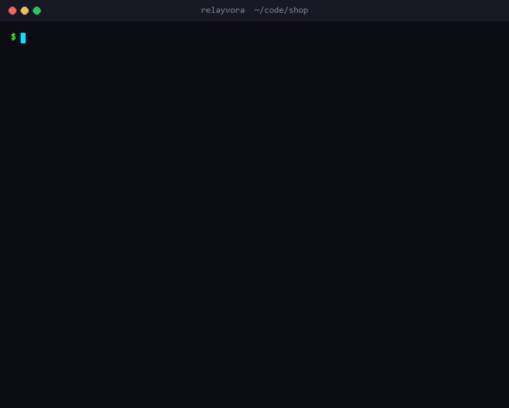
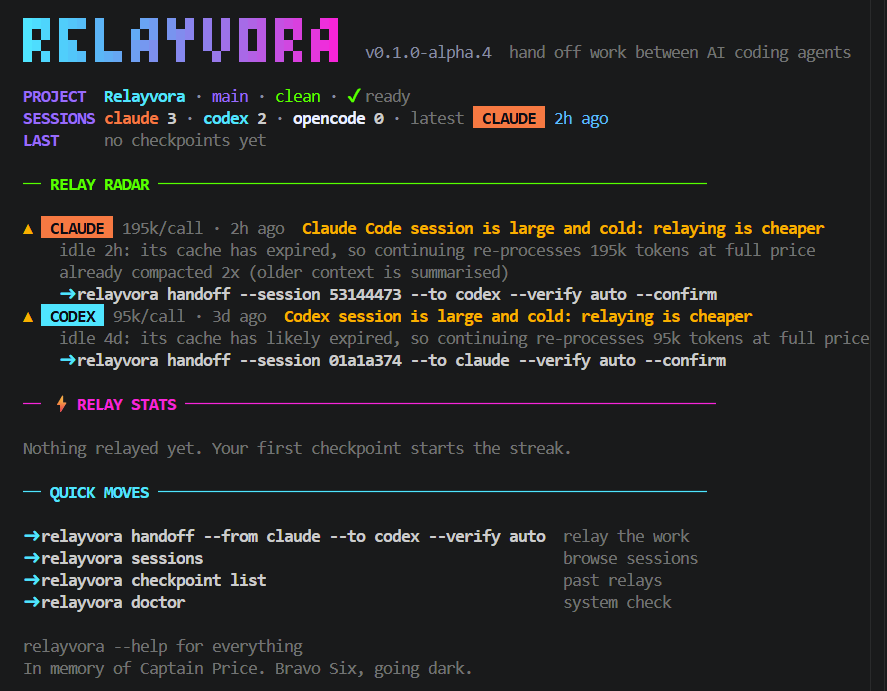

<div align="center">

# Relayvora

**Your agent went down mid-mission. Send in the next one.**

Hand unfinished work between Claude Code, Codex and OpenCode in seconds,
with a short, verified handoff instead of a 200k-token transcript.

`Claude Code ⇄ Codex ⇄ OpenCode` · `local-only` · `no telemetry` · `Windows · macOS · Linux`

<a href="https://www.producthunt.com/products/relayvora?embed=true&amp;utm_source=badge-featured&amp;utm_medium=badge&amp;utm_campaign=badge-relayvora" target="_blank" rel="noopener noreferrer"></a>

_In memory of Captain John Price. "Bravo Six, going dark."_



</div>

---

You're deep in a session. The agent hits its usage limit, or gets stuck, or the context has grown so big that
every call costs a fortune. Normally you'd open a new agent and spend twenty minutes explaining where you were.

**Relayvora does the briefing for you:**

- **Reads the session:** your goal, your recent requests, and what the agent last reported.
- **Checks the ground truth:** uncommitted changes, commits made during the session, and real test results.
- **Labels every fact:** `[observed]`, `[user]`, `[agent-reported]` or `[inferred]`, so the next agent knows what's
  verified and what's hearsay.
- **Launches the next agent** with the handoff loaded, in your terminal or your editor.
- **Follows you and your team:** pick up on another device, or send the handoff to a teammate's inbox, through
  the Git repository you already share. No extra account.
- **Works inside any MCP agent:** `relayvora mcp` lets Cursor, Copilot, Windsurf, Claude Code, Codex and others
  fetch handoffs, save checkpoints and check the inbox themselves.

```sh
relayvora handoff --from codex --to claude --verify auto --confirm
```

One command. New agent, full briefing, back in the fight.

> **Status: alpha.** Works end to end on Windows, macOS and Linux with the Claude Code, Codex and OpenCode CLIs, or the
> Claude Code and Codex VS Code / Cursor extensions. Measured honestly: it saves **tokens and context** on large sessions, **not money on
> small ones**. See [Does it save anything?](#does-it-save-anything).

## Install

Requirements: Node.js **22.13+** and Git 2.31+.

```sh
npm install -g relayvora
relayvora doctor              # checks Node, Git, the store, and finds Claude Code / Codex / OpenCode
```

Or try it without installing: `npx relayvora`. Remove it with `npm uninstall -g relayvora`.
Tarballs with a SHA-256 file and a signed build attestation are also on the
[releases page](https://github.com/Dagimassefa/Relayvora/releases); see
[verifying a download](docs/releasing.md#signed-draft-releases).

## Quick start

In any project where you have used Claude Code, Codex or OpenCode:

```sh
relayvora                                                        # home screen
relayvora handoff --from codex --to claude --verify auto --confirm
```

That finds your latest Codex session for the project, runs the project's own checks, builds the handoff, shows a
summary card, and (after you confirm) starts Claude Code in this terminal with the handoff loaded.

Hit limits often? `relayvora hooks install` saves a checkpoint automatically when it happens, so the handoff is ready
before you need it.

## How a relay works

1. **Read the session.** Your goal (the latest substantial request, or `--goal`), your recent requests and the
   agent's last report come from the session transcript. Injected context and IDE wrappers are stripped.
2. **Capture evidence.** Uncommitted diffs and new files, plus the commits you made since the session started.
   `.env` files, keys and binaries are never read; secrets in everything else are redacted before storage.
3. **Verify.** `--verify auto` runs the project's own typecheck/lint/test commands without a shell and records real
   exit codes. A checkpoint only says something passes if a command actually passed.
4. **Build the handoff** within a token budget (4,000 by default): goal, requests, blockers, test results and changed
   files always; failing output, then diffs, then new files while they fit; everything else as a "fetch this if
   needed" line. Every fact is labelled `[observed]`, `[user]`, `[agent-reported]` or `[inferred]`.
5. **Launch** the target agent with the handoff, or copy it for an editor panel.
6. **Measure** afterwards with `relayvora report`.

## Does it save anything?

Measured with the benchmark harness in [`packages/benchmarks`](packages/benchmarks/README.md): the same two-step
task done by continuing one session versus relaying to a fresh one, scored by hidden tests (Claude Code, Opus,
1-2 runs per arm, so directional rather than definitive).

| Next step after the switch | Small session (40k tok/call) | Large session (160k tok/call)     |
| -------------------------- | ---------------------------- | --------------------------------- |
| Cost: continue vs relay    | $0.127 vs $0.221 (**+73%**)  | $0.306 vs $0.308 (**about even**) |
| Input tokens               | +26%                         | **-60%**                          |
| Context per call           | about the same               | **-71%** (164k → 47k)             |
| Hidden tests passed        | 96% vs 100%                  | 100% vs 100%                      |

- **Small sessions: don't relay to save money.** A fresh session pays to set up its cache and get oriented.
- **Large sessions: big token and context savings**, but dollars only break even after **~10 calls** in the new
  session, because re-reading a warm cache is cheap (~$0.20/M tokens) and writing a new one is not (~$8/M).
- **Likely the biggest win, not yet benchmarked:** relaying after a break (you hit a limit and came back later).
  The old session's cache has expired by then, so continuing it means re-writing its whole context.
- Relay when you **hit a limit, want to switch agents, or a big session has gone cold or has a lot of work left**.

### Knowing when to relay

Relayvora works this out for you from each agent's own session records, and shows it on the home screen's
**relay radar**, the checkpoint card's **WORTH** row, and as live alerts from `relayvora watch`:

<p align="center">
  
</p>

| Signal                  | How it is detected                                                                                                                                                                        | Verdict                                                 |
| ----------------------- | ----------------------------------------------------------------------------------------------------------------------------------------------------------------------------------------- | ------------------------------------------------------- |
| Usage limit hit         | Claude Code: `rate_limit` API error ("You've hit your session limit · resets ..."); Codex: limit error or `rate_limit_reached_type`; OpenCode: a rate-limit (429) error from the provider | relay now                                               |
| Near a limit            | Codex reports used % of its 5-hour and weekly windows; 90% or more                                                                                                                        | relay soon                                              |
| Large session gone cold | Idle over an hour (Claude Code caches for 1 hour, measured) and 60k+ tokens per call                                                                                                      | relay: continuing re-processes everything at full price |
| Compacted               | Claude Code or OpenCode summarised the conversation because it grew too large                                                                                                                       | relay                                                   |
| Small, warm session     | Under ~60k tokens per call, recently active                                                                                                                                               | continue                                                |

```sh
relayvora watch --bell        # in a spare terminal; Ctrl+C to stop
```

## Commands

| Command                                                   | What it does                                                                                           |
| --------------------------------------------------------- | ------------------------------------------------------------------------------------------------------ |
| `relayvora`                                               | Home screen: project, sessions, **relay radar**, last relay, stats, suggested commands. Read-only.     |
| `relayvora hooks install` / `status` / `uninstall`        | Saves checkpoints automatically from agent hooks: limit hit, compaction, session end, turns.           |
| `relayvora watch [--interval 60] [--bell]`                | Alerts the moment a relay pays off: an agent hit or nears its limit, or a large session went cold.     |
| `relayvora doctor`                                        | Checks Node, platform/WSL, Git, the store, the project, and each agent (PATH or editor extension).     |
| `relayvora init`                                          | Registers the project (Git root) and creates `.relayvora/`, which ignores itself in Git.               |
| `relayvora sessions [-p claude\|codex\|opencode] [--all]` | Lists agent sessions for this project, newest first. Read-only.                                        |
| `relayvora handoff --to <agent> [options]`                | Creates a checkpoint and shows the card; `--confirm` launches the agent.                               |
| `relayvora checkpoint create [options]`                   | Same capture as `handoff`, without the launch options.                                                 |
| `relayvora checkpoint list` / `show <id>`                 | Lists checkpoints; prints a handoff (`--budget` re-renders it, `--format json`).                       |
| `relayvora checkpoint delete <id> [--dry-run] [-y]`       | Deletes a checkpoint in this project, its handoff, evidence and usage; asks first.                     |
| `relayvora checkpoint prune [--days 30] [--dry-run] [-y]` | Deletes expired checkpoints in this project using its retention setting, or the given age; asks first. |
| `relayvora launch <id> [--to <agent>]`                    | Starts the agent with an existing, possibly edited, handoff.                                           |
| `relayvora report [id] [--reverify]`                      | Measures a relay: the session that continued it, context per call, onboarding, checks.                 |
| `relayvora export [id] [--out file] [--with-changes]`     | Exports a checkpoint (default: the latest), re-redacted; a `.json` file can be imported elsewhere.     |
| `relayvora import <file\|id> [--apply-changes]`           | Imports a checkpoint exported elsewhere, or shared on the repo's branch, ready to `launch`.            |
| `relayvora sync [-y]`                                     | Shares this project's checkpoints through the repo and pulls those from your other devices.           |
| `relayvora send [id] --to <email> [--with-changes]`       | Sends a checkpoint to someone by their Git email; it lands in their inbox.                             |
| `relayvora inbox [--sent]`                                | Checkpoints sent to you in this repository (or that you sent), ready to launch.                        |
| `relayvora mcp`                                           | Runs an MCP server on stdio, so any MCP-capable agent can fetch handoffs and save checkpoints.         |
| `relayvora config show`                                   | Shows the data directory, database path and project config.                                            |

Global flags: `--json` (machine-readable), `-C/--cwd <dir>`, `-v/--verbose`, `--no-color`.

### Automatic checkpoints (hooks)

```sh
relayvora hooks install            # Claude Code + OpenCode (this project) + Codex; --scope user for all projects; --dry-run to preview
```

The handoff is then waiting before you need it. Claude Code runs Relayvora on:

| Event                        | When                                         | Checkpoint                       |
| ---------------------------- | -------------------------------------------- | -------------------------------- |
| `StopFailure` (`rate_limit`) | a turn ends because of a usage or rate limit | always, tagged `auto:limit`      |
| `PreCompact`                 | just before the conversation is compacted    | always                           |
| `SessionEnd`                 | the session ends                             | always                           |
| `Stop`                       | the end of a turn                            | at most every 15 min (`--every`) |

Codex runs it through its `notify` setting at the end of each turn (throttled the same way). OpenCode gets a small
plugin, `.opencode/plugins/relayvora.js` (or `~/.config/opencode/plugins/` with `--scope user`), that checkpoints
on `session.error` when it is a usage or rate limit, on `session.compacted`, and on `session.idle` at the end of a
turn (throttled). Hooks hand the work to a
background process and return in well under a second, so they never slow the agent; problems go to `hooks.log` in the
data directory. The newest 5 automatic checkpoints per session are kept (`--keep`). When the relay radar or `watch`
flags a limit and a hook already saved the latest state, the suggested command is simply `relayvora launch <id>`.

The installer merges into existing settings and leaves other hooks untouched, writes Claude Code hooks in exec form (no
shell, works on Windows), keeps `.claude/settings.local.json` and the OpenCode plugin out of Git, never replaces an
existing Codex `notify` program, and never overwrites an OpenCode plugin file it did not write. Claude Code runs hooks only in folders you have accepted in its workspace trust prompt.

### Handoff and checkpoint options

```sh
relayvora handoff --from codex --to claude \
  --goal "Fix leap-year handling" --constraint "Keep the public API" --pending "Handle years divisible by 400" \
  --verify auto --budget 4000 --confirm
```

| Option                                                                     | Meaning                                                                                                                                                                                                                   |
| -------------------------------------------------------------------------- | ------------------------------------------------------------------------------------------------------------------------------------------------------------------------------------------------------------------------- |
| `--from <agent>` / `--session <id>`                                        | Newest session of that agent in this project, or a specific one (id prefix is fine). Neither: build from the repository and your flags only.                                                                              |
| `--goal`, `--constraint`, `--done`, `--pending`, `--blocker`, `--decision` | Your own facts, labelled `[user]`; the last five are repeatable.                                                                                                                                                          |
| `--verify "<cmd>"` / `--verify auto`                                       | Run a check without a shell and record its exit code. `auto` finds `typecheck`, `lint`, `test` in `package.json` (right package manager), `ruff`/`pytest`, `go vet`/`go test`, `cargo test`, or a Makefile `test` target. |
| `--commits-since 2h` / `--no-commits`                                      | Window for commits included as completed work (default: the session start), or leave them out.                                                                                                                            |
| `--budget <tokens>`                                                        | Size cap for the handoff text (estimated tokens).                                                                                                                                                                         |
| `--copy`                                                                   | Copy the handoff to the clipboard for an editor panel.                                                                                                                                                                    |
| `--confirm`, `-y`, `--dry-run`, `--print`                                  | Launch the agent; skip the question; show the exact command only; print the full handoff text.                                                                                                                            |
| `--no-transcript`                                                          | Do not read the session transcript.                                                                                                                                                                                       |

### Launching

Relayvora starts the agent's interactive session in your terminal, in the project folder, through its documented
command line (`claude [prompt]`, `codex [PROMPT]`, `opencode --prompt <text>`). It uses the CLI on PATH, otherwise the copy bundled in your editor
extension. Just before launching it re-checks the repository against the checkpoint; if nothing changed, the agent is
told it can skip re-checking. The handoff file as it is on disk, including your edits, goes into the first message
when the command line allows, otherwise a short pointer to the file. It always asks first (`--yes` for scripts), and
every launch is recorded in the audit log with hashes of what was sent.

### Another machine

Start on your laptop, finish on your desktop. Export the checkpoint as JSON, carry the file over (USB, cloud drive,
chat to yourself) and import it inside a clone of the same repository:

```sh
# laptop
relayvora handoff --from claude --to codex
relayvora export --out handoff.json --with-changes

# desktop, in the project
git pull
relayvora import handoff.json --apply-changes
relayvora launch <id>
```

The import points the checkpoint at the local clone and includes your edits to the handoff file. Code moves through
Git: `import` says when the commit the work sits on has not been pushed yet. `--with-changes` also carries your
uncommitted work, untracked files included, as a patch; it never touches your staging area, leaves out sensitive files
such as `.env`, and refuses outright when the changes look like they contain secrets. `--apply-changes` applies the
patch only on the same commit and only when it applies cleanly; otherwise it is kept in `.relayvora/handoffs/`.

### Sharing: your devices and your team

No Relayvora account needed: your GitHub (or any Git host) login is the account. Shared checkpoints live on a
`relayvora/handoffs` branch of the project's own repository, so exactly the people who can read the code can read
them. Relayvora writes that branch with Git plumbing; your working tree, staging area and current branch are never
touched.

```sh
# every device: share yours, get the rest (full history on each one)
relayvora sync

# send to a teammate by the email they use with Git (git config user.email)
relayvora send --to alice@example.com --note "tests still fail on CI" --with-changes

# the teammate, in their clone
relayvora inbox
relayvora import <id> --apply-changes   # only if it carries changes
relayvora launch <id>
```

`relayvora inbox --sent` lists what you sent. Someone without access yet? Invite them to the repository by email
(on GitHub: Settings, Collaborators, Add people); once they accept and run `relayvora inbox`, it is there. `sync`
and `send` ask before publishing, since everyone with access to the repository can read what is on the branch.

### VS Code, Cursor and other editors

No global install is needed. The Claude Code and Codex extensions write sessions to `~/.claude` and `~/.codex` and
ship their own CLI, which Relayvora finds in VS Code, VS Code Insiders, Cursor, Windsurf, VSCodium and VS Code Server.
To continue in an editor panel instead of a terminal, add `--copy` and paste, or tell the agent the one-line message
the card prints (`Continue the task described in .relayvora/handoffs/<id>.md ...`).

### MCP server: any agent, no adapter needed

`relayvora mcp` serves the [Model Context Protocol](https://modelcontextprotocol.io) on stdio. Add it once and the
agent can work with Relayvora itself, including agents Relayvora has no adapter for:

| Tool                | What the agent can do                                                                              |
| ------------------- | -------------------------------------------------------------------------------------------------- |
| `get_handoff`       | Fetch a handoff (default: the latest) to continue; also finds ones synced or sent from elsewhere.  |
| `create_checkpoint` | Save its own goal, completed and pending steps, blockers and decisions, plus Git evidence.         |
| `list_checkpoints`  | List this project's checkpoints.                                                                   |
| `inbox`             | Check what teammates sent (fetches the `relayvora/handoffs` branch).                               |
| `import_checkpoint` | Import an export file or a shared checkpoint, optionally applying its uncommitted changes.         |

```sh
claude mcp add relayvora -- relayvora mcp      # Claude Code
codex mcp add relayvora -- relayvora mcp       # Codex
```

Cursor (`.cursor/mcp.json`), Windsurf (`~/.codeium/windsurf/mcp_config.json`) and others:

```json
{ "mcpServers": { "relayvora": { "command": "relayvora", "args": ["mcp"] } } }
```

VS Code / Copilot (`.vscode/mcp.json`): `{ "servers": { "relayvora": { "command": "relayvora", "args": ["mcp"] } } }`.
Without a global install, use `"command": "npx", "args": ["-y", "relayvora", "mcp"]`. Then ask the agent to "continue
from the Relayvora handoff" or to "save a Relayvora checkpoint". The server works in the editor's project folder; each
tool also takes a `project` path. It never pushes (`sync` and `send` stay at the terminal) and never runs commands.

### Measuring a relay

```sh
relayvora report --reverify
```

`report` finds the session that continued a checkpoint (started after it, with a prompt mentioning its id, whether
launched or pasted) and shows, from the agents' own usage records: turns, duration, tokens and cost of that session,
**context per call** before and after the relay, **onboarding** (calls and tokens before its first edit), a token
payback estimate, and with `--reverify` whether the checkpoint's checks pass now. Results are summarised on the home
screen.

## Terminal output

Colour adapts to the terminal and turns off when output is piped, with `--json`, `--no-color` or `NO_COLOR`
(`FORCE_COLOR=1..3` forces it on; `RELAYVORA_ASCII=1` avoids Unicode block characters). Progress and the summary card
go to stderr, so `relayvora handoff ... > handoff.md` captures only the Markdown.

| Exit code | Meaning                                                                                         |
| --------- | ----------------------------------------------------------------------------------------------- |
| 0         | OK                                                                                              |
| 1         | Failure                                                                                         |
| 2         | Usage error (bad flag, unknown agent, missing goal)                                             |
| 3         | Not found (no session, no checkpoint, agent not installed)                                      |
| 4         | Unsupported                                                                                     |
| 5         | Cancelled                                                                                       |
| 6         | Precondition failed (confirmation needed without a terminal, `doctor` found a blocking problem) |

## Privacy and data

Checkpoint retention defaults to **30 days**, applied for the current project after a new checkpoint is saved.
Set `retentionDays` in `.relayvora/config.json` to a positive number of days, or `null` to keep everything.
To preview or apply cleanup immediately:

```sh
relayvora checkpoint prune --dry-run
relayvora checkpoint prune --yes
relayvora checkpoint delete <id> --dry-run
relayvora checkpoint delete <id> --yes
```

Cleanup removes Relayvora's checkpoint, handoff file, evidence and usage records. Vendor session transcripts
and audit events are kept. Automatic hook checkpoints also obey their per-session `--keep` limit.
Retention is age-based, so it also removes edited handoff files once their checkpoint expires; export anything you want to keep.

- **Local only.** Nothing is uploaded and there is no telemetry. `sync` and `send` push to your own Git remote, and
  only when you run them and confirm. The one network request: at most once a day the home
  screen asks the npm registry for the latest version, to show an update notice. It sends nothing about you or your
  projects; turn it off with `RELAYVORA_NO_UPDATE_CHECK=1` (it is also skipped when `CI` is set).
- **Global store:** SQLite at `%LOCALAPPDATA%\relayvora` (Windows), `~/Library/Application Support/relayvora`
  (macOS), `$XDG_DATA_HOME/relayvora` or `~/.local/share/relayvora` (Linux). Override with `RELAYVORA_HOME`.
- **Per project:** `.relayvora/` (config and handoff files), ignored by Git through its own `.gitignore`.
- **Exports** stay wherever you put them. A JSON export holds the redacted checkpoint and, with `--with-changes`,
  your uncommitted code, so treat the file like the code itself.
- **Agent sessions** are read from `CLAUDE_CONFIG_DIR` (default `~/.claude`), `CODEX_HOME` (default `~/.codex`) and
  OpenCode's database at `$XDG_DATA_HOME/opencode/opencode.db` (default `~/.local/share/opencode`, on Windows too),
  opened read-only and never written to. Session formats are not documented by the vendors, so reading them is best-effort.

More in [docs/security/threat-model.md](docs/security/threat-model.md) and
[docs/architecture/overview.md](docs/architecture/overview.md).

## Repository layout

```
apps/cli/                  the relayvora command: commands, launch, report, terminal UI
packages/core/             checkpoint schema, handoff builder and renderer, redaction, check detection, safe subprocess
packages/storage/          SQLite store (node:sqlite) with versioned migrations
packages/git/              read-only Git evidence: status, diffs, untracked files, session commits
packages/adapter-claude/   Claude Code: session discovery, transcript reading, launch
packages/adapter-codex/    Codex: session discovery, transcript reading, launch
packages/adapter-opencode/ OpenCode: sessions and transcripts from its SQLite database, launch
packages/benchmarks/       normal-vs-relay benchmark harness, tasks, hidden tests and results
fixtures/                  synthetic session files for adapter tests
docs/                      architecture and security notes
```

## Development

To build from source you also need pnpm 10:

```sh
pnpm install
pnpm build
cd apps/cli && npm link   # global `relayvora` from source; `npm unlink -g @relayvora/cli` removes it
pnpm test        # vitest against source, no build needed
pnpm build       # tsc -b with project references
pnpm bench:plan  # preview benchmark jobs without agent calls
node packages/benchmarks/run.mjs --tasks small-calculator --agents claude --reps 3 --run # spends real agent usage
pnpm release:pack  # standalone npm tarball + SHA-256 in release/
pnpm release:smoke # offline install and CLI lifecycle checks
```

CI runs the build, the tests and a CLI smoke test on Windows, macOS and Linux with Node 22 and 24.

## Roadmap

- [x] CLI foundation: `init`, `doctor`, `sessions`, SQLite store, safe subprocesses, cross-platform paths
- [x] Checkpoints: Git and commit evidence, transcript digests, `--verify` / `--verify auto`, budgeted handoffs, `export`
- [x] Launching: `handoff --confirm` and `launch`, via the CLI or the editor-extension copy, with a freshness check
- [x] Measurement: `report`, onboarding and payback, home-screen stats
- [x] Benchmark harness with small and large tasks and hidden-test scoring
- [x] Relay radar, `watch`, and automatic checkpoints from Claude Code hooks, Codex notify and an OpenCode plugin
- [x] Retention enforcement and confirmed delete/prune commands with previews
- [x] Cold-resume benchmark support, Claude/Codex arms, three tasks and configurable repetitions
- [x] OpenCode support: sessions, transcripts, usage and limits from its database, and launching
- [x] Standalone release packaging, checksums, installation smoke tests and a signed-attestation release workflow
- [x] Cross-machine handoffs: `export` and `import`, optionally carrying uncommitted work
- [x] Sharing through the repository: `sync` across your devices, `send` and `inbox` between people
- [ ] Run the expanded live benchmark matrix and publish its measurements (consumes agent usage)
- [x] Published on npm as `relayvora`
- [ ] Signed GitHub releases from the release workflow (needs a public repository); see [release instructions](docs/releasing.md)
- [x] MCP server (`relayvora mcp`), so any MCP-capable agent can fetch handoffs, save checkpoints and check the inbox
- [ ] More agents: Gemini CLI, Cursor CLI
- [ ] **Version two:** dedicated VS Code extension

## License

[MIT](LICENSE)
